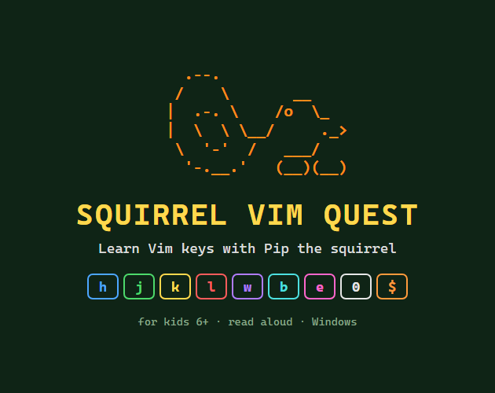
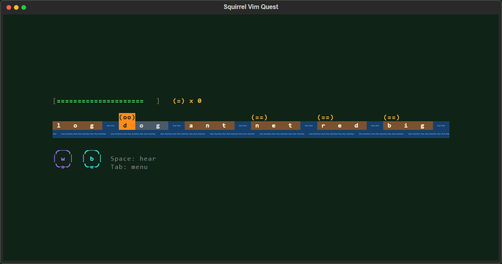
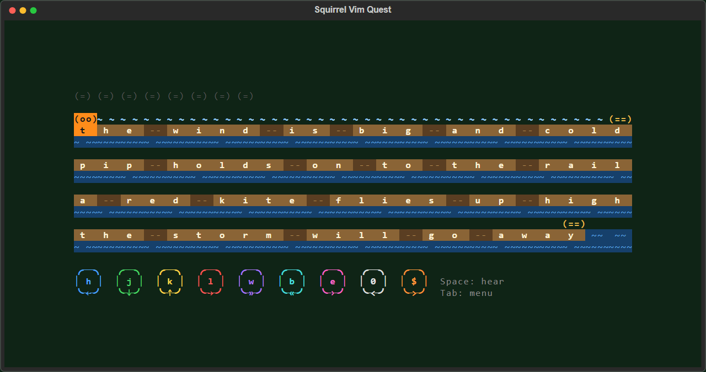

# Squirrel Vim Quest



**[Download for Windows](../../releases/latest)**: unzip, then double-click `install.cmd` or `SquirrelVimQuest.exe`.

| Word River | Line Bridge |
| --- | --- |
|  |  |

A terminal game that teaches Vim motions to young kids (age 6). Pip the squirrel
*is* the cursor. Three islands: Arrow Island (`h j k l`), Word River (`w b e`)
and Line Bridge (`0 $`).

## Play

Double-click `play.bat`, or:

```
.venv\Scripts\python -m squirrel_vim_quest
```

Keys: `h j k l` move, `Enter` plays a stone, `Space` repeats the spoken line,
`Tab` opens the menu (sound on/off, map, quit). Arrow keys are blocked on purpose.

## Setup (first time)

```
python -m venv .venv
.venv\Scripts\python -m pip install -e .[dev]
```

## Arrow Island

| Stone | Stage | Game |
| --- | --- | --- |
| 1 | Meet | Each key is shown, a ghost Pip acts it out, the child presses it 3 times |
| 2 | Puzzle | Eat one acorn. Par 6 |
| 3 | Puzzle | Eat 3 acorns around rocks. Par 13 |
| 4 | Action | Acorn Garden: 45 s, acorns pop up and vanish, a slow snail wanders |
| 5 | Boss | Fox Maze: eat 4 acorns, the gate opens, 2 foxes chase |

## Word River (opens after the Fox Maze)

Words are logs, spaces are water. Text is lowercase words only, so `w` and `W` agree.

| Stone | Stage | Game |
| --- | --- | --- |
| 1 | Meet | `w` jumps to the next log, `b` jumps back |
| 2 | Puzzle | Reach the flag log. Par 6 with `w`; `l` works but scores 1 star |
| 3 | Action | Frog River: 45 s, logs drift left, the log under Pip sinks, acorns on log starts |
| 4 | Bonus | Meet `e`, then a puzzle with acorns on log ends. Par 6 |
| 5 | Boss | Fish Rapids: 3 lines, `w b e j k`, fish splash near Pip, gold acorns on log ends need `e` for 3 stars |

## Line Bridge (opens after the Fish Rapids)

Each line is a bridge; `0` goes to its start, `$` to its end.

| Stone | Stage | Game |
| --- | --- | --- |
| 1 | Meet | `$` then `0`; Pip hops back between presses so each press moves |
| 2 | Puzzle | Acorns at bridge starts and ends over 4 bridges. Par 6: `$ j j j k 0` |
| 3 | Action | Ping-Pong: a ball rolls to one end of a bridge, stand there to catch it (`0 $ j k`) |
| 4 | Puzzle | Acorns mid-bridge: `0` or `$` first, then `w b e`. Par 8 |
| 5 | Boss | Storm Bridge: eat 8 acorns that pop up anywhere; leave a windy bridge with `j`/`k` before it blows |

## Code map

- `squirrel_vim_quest/engine/`: grid, motions, solver (par, hints, enemy chasing),
  and `text.py`: Vim's word motions, checked against a real Vim by `tests/test_text_vs_vim.py`
- `squirrel_vim_quest/levels/islandN/stoneN.yaml`: level data (maps or text, par, speeds)
- `squirrel_vim_quest/strings/en.yaml`: every shown and spoken line
- `squirrel_vim_quest/screens/`: title, map, meet, puzzle, garden, maze, river, rapids,
  pong, storm, results, pause; `board.py` lets meet and puzzle run on a grid or on
  text (river or bridge look)
- `squirrel_vim_quest/audio.py`: Windows voice (picks an English voice) and sound effects

Progress is saved in `%APPDATA%\SquirrelVimQuest\save.json`.

## Share with friends

```
powershell -ExecutionPolicy Bypass -File packaging\build.ps1
```

This runs the tests, builds `dist\SquirrelVimQuest.exe` (one file, no Python
needed, about 13 MB), runs the exe's own `--check`, and packs
`dist\SquirrelVimQuest-<version>-windows.zip` with:

- `SquirrelVimQuest.exe`: double-click to play, nothing to install
- `install.cmd`: copies the game to `%LOCALAPPDATA%\Programs\SquirrelVimQuest`,
  adds Desktop and Start Menu shortcuts, and puts `SquirrelVimQuest` on the user's
  PATH so it runs from any terminal folder (no admin rights needed)
- `uninstall.cmd`: removes all of that; saved stars stay
- `PLAYERS.txt`: a one-page guide for grown-ups

The exe is not code-signed, so Windows SmartScreen asks "Windows protected your
PC" the first time: "More info", then "Run anyway". Started from a plain console,
the game reopens itself in Windows Terminal when that is installed (`--no-wt`
turns this off). `SquirrelVimQuest --check` prints the levels, voice and save
folder it finds, which helps on a friend's PC.

To change the version, edit `__version__` in `squirrel_vim_quest/__init__.py`.

For the itch.io page, `packaging\itch_assets.py` makes the cover, banner and
screenshots in `dist\itch\` from the real game, and `packaging/ITCH.md` has the
page text and every upload setting.

## Tests

```
.venv\Scripts\python -m pytest
```

`SVQ_MUTE=1` silences audio; `SVQ_DATA_DIR` moves the save folder.
